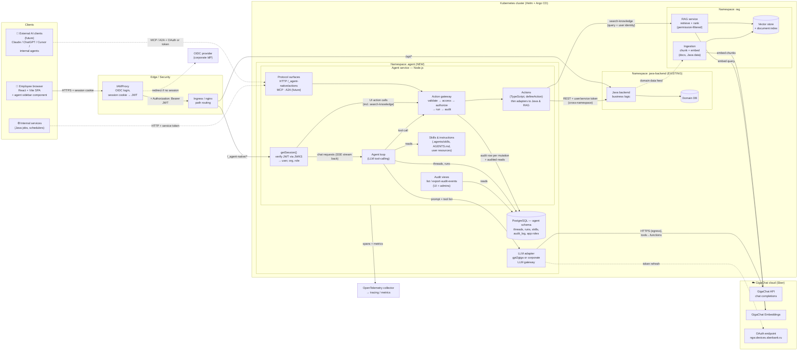
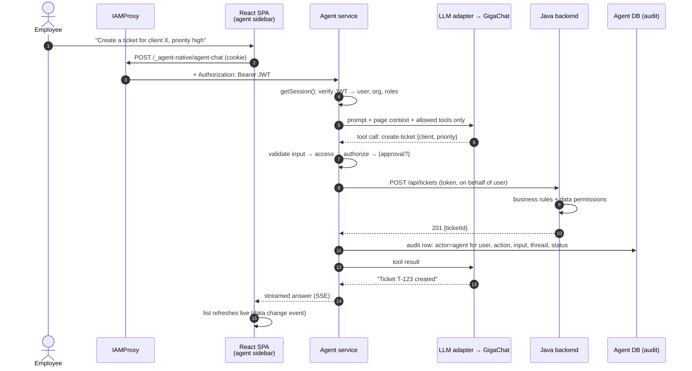
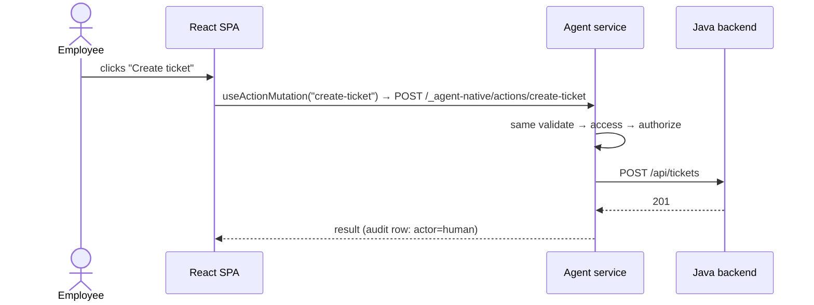
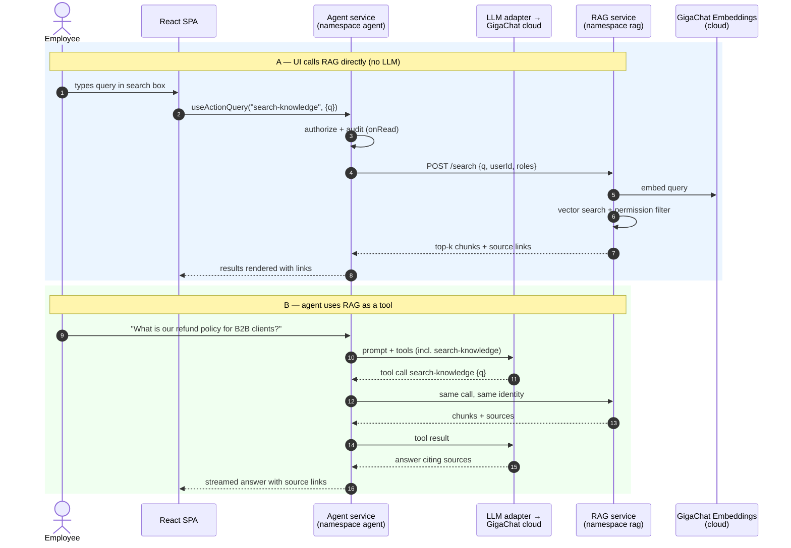
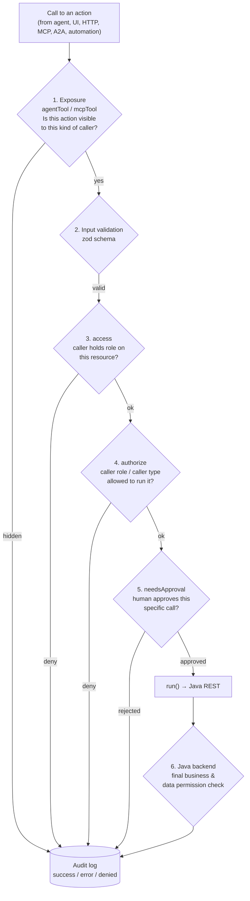
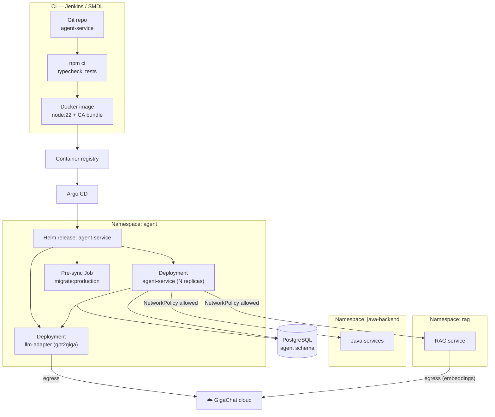
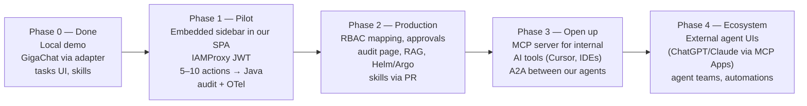
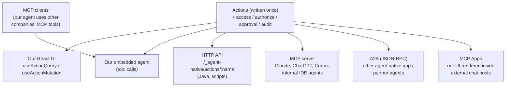

# Solution Architecture: AI Agent Layer on agent-native

> **Purpose:** Explain what we get by adding an AI agent layer to our
> product with the open-source [agent-native](https://github.com/BuilderIO/agent-native)
> framework (MIT, by Builder.io): the target architecture, how it fits
> our enterprise standards, how we control and audit what the agent
> does, and how it grows into A2A / MCP / external agent UIs later.
>
> **Audience:** Product owner, team lead, architects, security.
>
> **Status of claims:** Every capability below is marked:
>
> - ✅ **verified** — checked in the framework source/docs and/or run in our local demo;
> - 📄 **documented** — stated in the framework docs, not yet tried by us;
> - 🔧 **integration work** — not provided out of the box; we build it.
>
> **Assumptions:** Java backend owns all business logic; IAMProxy (OIDC)
> fronts every request and injects a validated JWT; Kubernetes + Helm +
> Argo CD for deployment; Java backend runs in its **own namespace**;
> GigaChat is consumed as a **cloud API** (Sber); a RAG service provides
> knowledge search; PostgreSQL available.

---

## 1. Executive summary

**What it is.** A TypeScript framework where every business capability
is written **once** as an _action_. That one action is simultaneously:

- a button/hook in our React UI,
- a tool the AI agent can call,
- an HTTP endpoint,
- an MCP tool and an A2A skill for other AI agents.

**What we get.** An AI assistant embedded in our existing React app that
can _do work_ in our product (create, update, search, summarize) through
the **same validated, permission-checked operations** the UI uses — not
by scraping screens, and not via a second, unaudited backend.

**What it is not.** It does not replace the Java backend. Business rules
stay in Java. The agent layer is a thin Node.js service whose actions
call Java REST APIs.

**Recommendation.** Proceed with a **time-boxed pilot** (one domain, a
handful of read + low-risk write actions, internal users only), gated on
three open decisions listed in [§10](#10-open-decisions-and-risks):
the Nitro policy, the LLM choice, and the Java authentication pattern.

---

## 2. Target architecture — components and who calls whom



### 2.1 Component responsibilities

| Component                                   | Owner               | Responsibility                                                                                                                                                         | Status                                            |
| ------------------------------------------- | ------------------- | ---------------------------------------------------------------------------------------------------------------------------------------------------------------------- | ------------------------------------------------- |
| React SPA + agent sidebar                   | Frontend team       | Existing UI; adds `<AgentSidebar>` / `<AgentNativeEmbedded>`; passes page context (current record, route) to the agent                                                 | ✅ verified (demo)                                |
| IAMProxy                                    | Platform/IAM        | OIDC login; injects validated JWT on every request                                                                                                                     | existing                                          |
| Agent service (Node.js) — namespace `agent` | Our team            | Hosts actions, agent loop, skills, audit, protocols. **No business logic** — calls Java and RAG                                                                        | ✅ verified (demo)                                |
| `getSession()`                              | Our team            | Verifies JWT (signature, issuer, audience, expiry) and maps claims → user/org/role                                                                                     | ✅ hook verified in source; 🔧 our implementation |
| Actions                                     | Our team            | Typed adapters: input schema (zod) → call Java REST or RAG → return result                                                                                             | ✅ verified (demo)                                |
| Java backend — namespace `java-backend`     | Backend team        | Unchanged business logic; final authority on data permissions. Reached from the agent namespace over the cluster network (NetworkPolicy allow-list)                    | existing                                          |
| RAG service — namespace `rag`               | Our team / platform | Retrieves relevant document chunks for a query; **filters by the caller's permissions**; ingestion embeds documents and Java data                                      | 🔧                                                |
| LLM adapter — namespace `agent`             | Platform            | Makes the GigaChat cloud API speak the OpenAI protocol (OAuth refresh, `tools`→`functions`, TLS CA). The **only** component with egress to GigaChat chat               | ✅ verified (demo, `gpt2giga`)                    |
| GigaChat (cloud)                            | Sber                | Chat completions + Embeddings models (`Embeddings`, `Embeddings-2`, `EmbeddingsGigaR`)                                                                                 | ✅ models listed via API                          |
| PostgreSQL (agent schema)                   | DBA                 | Framework tables only: chat threads, runs, skills/resources, audit log, app roles. **Separate schema/DB from domain data**                                             | 📄 documented                                     |
| Audit views                                 | Our team            | Audit trail is **read from the agent DB** via `list-audit-events` / `export-audit-events` (UI page for users, CSV/NDJSON export for admins). No push from the database | 📄 documented                                     |
| OTel collector                              | Platform            | Traces, metrics                                                                                                                                                        | 📄 documented                                     |

### 2.2 Key design rule

> **The agent can only do what an action allows, and an action can only
> do what Java allows.** There is no "agent backend" with its own data
> access path. Disable raw SQL tools (`frameworkTools.database: "off"`)
> so actions are the only way in. 📄

---

## 3. Request flows

### 3.1 User asks the agent to do something



### 3.2 The same action from the UI (no LLM involved)



**Why this matters:** one implementation, one set of checks, one audit
trail — for humans, the agent, and external agents alike. ✅ verified in
demo (tasks created by chat and by button go through the same action).

### 3.3 RAG — knowledge search for both UI and agent

RAG is exposed as **one action**, e.g. `search-knowledge`. The UI calls it
as a search box / "related documents" panel; the agent calls the same
action as a tool when it needs facts. Both go through the same
authorization and the same audit.



```ts
// actions/search-knowledge.ts — one action, two consumers (UI + agent)
export default defineAction({
  description:
    "Search internal knowledge base. Use for policies, procedures, product docs.",
  schema: z.object({
    q: z.string().min(2),
    limit: z.number().max(20).default(8),
  }),
  http: { method: "GET" },
  readOnly: true,
  audit: { onRead: true }, // knowledge reads are audited too
  run: async ({ q, limit }, ctx) =>
    ragClient.search({ q, limit, user: ctx?.userEmail, org: ctx?.orgId }),
});
```

| Design point                                    | Decision                                                                                                             |
| ----------------------------------------------- | -------------------------------------------------------------------------------------------------------------------- |
| Who enforces document permissions?              | **The RAG service**, using the identity passed by the action. The agent must never see chunks the user couldn't open |
| Why not let the UI call RAG directly via nginx? | Possible, but then UI and agent use different paths, permissions and audit. Going through the action keeps one path  |
| Embeddings                                      | GigaChat Embeddings (cloud) — same provider, same data-classification approval as chat                               |
| Grounding                                       | Return source links with every chunk; skill/instructions tell the agent to cite them                                 |
| Status                                          | 🔧 RAG service is integration work; the action pattern is standard (✅ actions verified in demo)                     |

---

## 4. Benefits

| Benefit                                            | What it means for the product                                                                 | Status                                                         |
| -------------------------------------------------- | --------------------------------------------------------------------------------------------- | -------------------------------------------------------------- |
| **Write once, use everywhere**                     | One action = UI hook + agent tool + HTTP + MCP + A2A. No duplicate "AI API"                   | ✅                                                             |
| **Agent works _with_ the UI, not around it**       | Agent changes appear in the UI live; agent sees the current screen/record via page context    | ✅ (live updates verified)                                     |
| **Same security path for human and agent**         | Validation, authorization, and audit run identically regardless of caller                     | 📄 (pipeline documented, source checked)                       |
| **Built-in audit trail**                           | Every mutation records _who_, _agent or human_, _which chat turn_, inputs (redacted), outcome | 📄                                                             |
| **Human-in-the-loop**                              | `needsApproval` pauses the agent before risky actions until a person approves                 | 📄                                                             |
| **Business users extend behavior without deploys** | Skills, instructions (`AGENTS.md`), scheduled tasks, automations editable at runtime          | ✅ (file skills) / ⚠️ (UI-created skills failed with GigaChat) |
| **Future-proof integration**                       | Same actions exposed over MCP/A2A later — no rewrite                                          | 📄                                                             |
| **LLM-agnostic**                                   | OpenAI-compatible, Anthropic, Google, Mistral, …; swap via config                             | ✅ (GigaChat via adapter)                                      |
| **Open source, MIT**                               | No vendor lock-in; can fork                                                                   | ✅                                                             |
| **Standard observability**                         | OpenTelemetry spans/metrics for runs, model calls, tool calls                                 | 📄                                                             |

---

## 5. Pros and cons

### Pros

- Clean separation: **Java = business truth**, Node agent layer = orchestration.
- Security model is declarative and lives next to the code it protects (reviewable in PRs).
- Fast to add capabilities: a new action is ~20 lines wrapping an existing Java endpoint.
- Rich ready-made UI (chat, history, skills, approvals, audit views) — we don't build a chat product.
- Works with our existing React/Vite frontend (embedded sidebar, no rewrite).

### Cons / costs

| Con                                                                                                                       | Impact                                                                                                                | Mitigation                                                                                                                                                              |
| ------------------------------------------------------------------------------------------------------------------------- | --------------------------------------------------------------------------------------------------------------------- | ----------------------------------------------------------------------------------------------------------------------------------------------------------------------- |
| **Nitro is a hard npm dependency** and the official build/runtime uses it                                                 | Conflicts with our "no Nitro" policy                                                                                  | Core runtime is h3-based and doesn't import Nitro; host on plain Node + h3 (🔧, unsupported path) or obtain a policy exception for build-time use. **Decision needed.** |
| **Fast-moving, young project** (v0.209, frequent releases, Nitro dep is a beta)                                           | Upgrade churn; possible breaking changes                                                                              | Pin versions; upgrade on a schedule; keep actions thin                                                                                                                  |
| **New runtime in the stack** (Node.js service + Postgres schema)                                                          | Ops/on-call, patching, monitoring                                                                                     | Standard Helm chart; reuse platform OTel                                                                                                                                |
| **LLM is an external cloud API**                                                                                          | Data leaves the cluster; dependency on Sber availability                                                              | Egress only from the LLM adapter; agree data classification for prompts; timeouts/retries in the adapter                                                                |
| **LLM quality drives UX**                                                                                                 | In our demo GigaChat: claimed a skill was saved when it wasn't; answered from stale history; loosely followed formats | Pilot with read + low-risk writes; `needsApproval` on risky ones; evaluate stronger models/gateway                                                                      |
| **GigaChat is not OpenAI-native**                                                                                         | Needs adapter (OAuth refresh, `functions` format, Russian root CA, no `reasoning_effort: none`)                       | `gpt2giga` (verified) or corporate gateway                                                                                                                              |
| **App roles stored in framework DB**, not read from IdP                                                                   | Second place to manage roles                                                                                          | 🔧 map JWT claims → roles in our auth layer (see §6.3)                                                                                                                  |
| **Background runs have no user JWT**                                                                                      | Can't forward user token for scheduled/long runs                                                                      | Service account + "on behalf of" or token exchange (see §7.2)                                                                                                           |
| **Not every framework feature fits enterprise** (telemetry to PostHog/Sentry, Builder.io cloud features, email providers) | Unwanted egress                                                                                                       | Disable/point to internal endpoints; egress allow-list                                                                                                                  |

---

## 6. Role model — controlling what the agent may do

### 6.1 Layers of control



| Layer           | Mechanism                                                                                                            | Example                                                 | Status                                        |
| --------------- | -------------------------------------------------------------------------------------------------------------------- | ------------------------------------------------------- | --------------------------------------------- |
| Exposure        | `agentTool: false`                                                                                                   | Action usable by user in UI, **invisible to the agent** | 📄                                            |
| Exposure        | `mcpTool: false`                                                                                                     | Our own agent may use it, external agents may not       | 📄                                            |
| Resource access | `access` / `assertAccess()`                                                                                          | Only editors of record #42 may change it                | 📄                                            |
| Role            | `authorize: roles.requireAny("manager")`                                                                             | Only managers may approve                               | 📄                                            |
| Caller-aware    | `authorize: (args, ctx) => …` using `ctx.caller` (`"tool"` = agent, `"frontend"`, `"mcp"`, `"a2a"`, `"automation"`…) | User may delete; agent acting for the same user may not | ✅ signature verified in source; 🔧 our guard |
| Human approval  | `needsApproval: true` or predicate                                                                                   | Agent may _propose_ a payment > 10k, a human confirms   | 📄                                            |
| Framework tools | `frameworkTools: { database: "off", … }`, `codeExecution: "off"`                                                     | No raw SQL, no code execution for the agent             | 📄 (code execution off by default)            |
| Final authority | Java permission checks                                                                                               | Java never trusts the agent layer blindly               | existing                                      |

### 6.2 Example: "user can, agent cannot"

```ts
// actions/delete-contract.ts
export default defineAction({
  description: "Delete a contract.",
  schema: z.object({ id: z.string() }),
  // Option A — simplest: the agent never even sees this tool
  agentTool: false,

  // Option B — agent sees it, but only managers' agents may run it,
  // and a human must approve every agent call
  // authorize: (args, ctx) =>
  //   ctx?.caller !== "tool" || ctx.appRoles?.includes("manager") === true,
  // needsApproval: true,

  audit: { target: (a) => ({ type: "contract", id: a.id }) },
  run: async ({ id }) => javaClient.delete(`/api/contracts/${id}`),
});
```

### 6.3 Where roles come from (🔧 integration work)

- The framework has **org roles** and **per-app roles** (`defineAppRoles`,
  stored in its `app_member_roles` table, editable on a team page). 📄
- Our source of truth is the **IdP** (groups/claims in the JWT).
- Plan: `getSession()` maps JWT claims → `orgRole`; for app roles either
  (a) sync IdP groups → `app_member_roles` on login, or
  (b) write `authorize` guards that read claims we place in request context.
  Choose one in the pilot; (a) keeps the framework's team UI usable.

### 6.4 Recommended defaults for production

| Setting                      | Value                                          | Why                            |
| ---------------------------- | ---------------------------------------------- | ------------------------------ |
| `frameworkTools.database`    | `"off"`                                        | Actions are the only data path |
| `codeExecution.production`   | `"off"` (default)                              | No shell / code exec           |
| Raw shell / filesystem tools | not registered (default in production)         | —                              |
| `needsApproval`              | on every irreversible / external-facing action | human-in-the-loop              |
| `mcpTool`                    | `false` by default until MCP is approved       | no external exposure           |
| `AUTH_DISABLED`              | never set                                      | demo-only flag                 |

---

## 7. Authentication and identity

### 7.1 User requests (IAMProxy)

1. IAMProxy guarantees a session; injects `Authorization: Bearer <JWT>`.
2. Agent service `getSession()` **re-verifies** the JWT (JWKS, `iss`, `aud`,
   `exp`) — defense in depth; never trust the header blindly.
3. Maps `sub` → stable `userId` (not email — emails change), plus org/role.
4. The built-in login pages and Better Auth are never shown.

✅ hook and fallback order verified in source (`server/auth.ts`).
Note: don't put the raw JWT into the session `token` field — the
framework uses that field for its own session cookies.

### 7.2 Calling Java from actions

| Pattern                           | How                                                                       | Covers                                      | Recommendation          |
| --------------------------------- | ------------------------------------------------------------------------- | ------------------------------------------- | ----------------------- |
| A. Forward user JWT               | Capture header in request context, actions reuse it                       | Interactive chat only                       | Pilot only              |
| B. Token exchange (RFC 8693)      | Agent service exchanges user JWT for a Java-audience token                | Interactive                                 | Good if IdP supports it |
| C. Service account + on-behalf-of | Client-credentials token + verified user id; Java authorizes as that user | Everything incl. background runs, schedules | **Target**              |

Why not A long-term: background agent runs and scheduled tasks have no
live request/JWT, and JWTs can expire mid-run.

### 7.3 Machine callers

External/internal services use the framework's minted tokens or
**service principals** (actor recorded as `service`). 📄

---

## 8. Audit and observability — "what did the agent do?"

### 8.1 Audit log (📄 built in)

Every **mutating** action call appends a row to `agent_audit_log`:

| Field               | Example                                         |
| ------------------- | ----------------------------------------------- |
| action              | `create-ticket`                                 |
| actor_kind          | `agent` / `human` / `service` / `system`        |
| actor email / user  | agent **acting for** `ivanov@corp`              |
| caller (surface)    | `tool`, `frontend`, `http`, `cli`, `mcp`, `a2a` |
| thread_id / turn_id | links to the exact chat turn that caused it     |
| status              | `success` / `error` / `denied`                  |
| input               | call arguments, **secrets redacted**            |
| target              | resource type + id (declared per action)        |

- **Append-only** — no update/delete API; only a retention purge
  (`AGENT_NATIVE_AUDIT_RETENTION_DAYS`, default 365, `0` = forever).
- **Denials are recorded too** (authorization runs inside the audit wrapper).
- Sensitive **reads** can be audited with `audit: { onRead: true }`.
- Query: `list-audit-events`, `get-audit-event`, `export-audit-events`
  (CSV/NDJSON) — also usable from UI ("who changed this?") and by the agent.
- **How the audit is consumed:** the database does **not** push events
  anywhere. Audit is _pulled_ through actions:
  - an **audit page in our UI** (`useActionQuery("list-audit-events", …)`) —
    users see their own and their agent's changes, admins see the org;
  - **CSV/NDJSON export** (`export-audit-events`) for compliance reviews;
  - the agent itself can answer "what did you change?" from the same trail.
    If a central log store is required later, a scheduled job can call
    `export-audit-events` over HTTP — still no DB-side integration. 🔧

### 8.2 Observability (📄)

- OpenTelemetry spans: `invoke_agent` (per run), `chat {model}` (per LLM call),
  `execute_tool {tool}` (per action) — token usage, model, status.
- Metrics: request duration, LLM latency, token usage, runs, tool calls.
- No-op until we register a provider → plugs into our existing collector.
- Built-in dashboard: conversations, user feedback, evals.

### 8.3 Answering typical audit questions

| Question                                       | Where                                    |
| ---------------------------------------------- | ---------------------------------------- |
| "Did a human or the agent delete this?"        | audit log `actor_kind` + `caller`        |
| "Which conversation caused it?"                | `thread_id` / `turn_id` → chat history   |
| "What exactly did the agent send?"             | audit `input` (redacted)                 |
| "What did the agent try but was blocked from?" | audit `status = denied`                  |
| "How much LLM usage per team?"                 | OTel metrics `gen_ai.client.token.usage` |

---

## 9. Fit with enterprise standards

| Standard                 | How we comply                                                                                                                                                                              | Status             |
| ------------------------ | ------------------------------------------------------------------------------------------------------------------------------------------------------------------------------------------ | ------------------ |
| **No Nitro (policy)**    | Option 1: host core on plain Node + h3 (no Nitro at runtime; Nitro still in the dependency tree). Option 2: fork and remove the dependency. Option 3: policy exception for build-time only | ⚠️ decision        |
| **SSO / OIDC**           | IAMProxy + `getSession()` JWT verification                                                                                                                                                 | ✅ hook verified   |
| **RBAC**                 | IdP claims → org/app roles; `authorize`/`access` on actions; Java final check                                                                                                              | 🔧 mapping         |
| **Audit**                | Built-in append-only audit in the agent DB; read via audit UI page and CSV/NDJSON export (pull, no DB push)                                                                                | 📄 + 🔧 audit page |
| **Observability**        | OpenTelemetry → existing collector                                                                                                                                                         | 📄                 |
| **Database**             | PostgreSQL, **dedicated schema/DB** for agent tables; migrations via `migrate:production` in a pre-deploy job                                                                              | 📄                 |
| **CI/CD**                | Jenkins/SMDL builds a Node image → registry → Helm chart → Argo CD (same flow as Java services, see `platform-blueprint.md`)                                                               | 🔧                 |
| **Namespaces & network** | `agent`, `java-backend`, `rag` namespaces; NetworkPolicies allow only agent → Java, agent → RAG                                                                                            | 🔧                 |
| **Network egress**       | Only the LLM adapter (and RAG embeddings) may reach GigaChat cloud; disable PostHog/Sentry or point to internal                                                                            | 🔧                 |
| **Data residency / LLM** | GigaChat (RU-hosted) or internal gateway; no data to foreign LLMs unless approved                                                                                                          | decision           |
| **TLS**                  | Russian Trusted Root CA in the image trust store for Sber endpoints                                                                                                                        | ✅ verified need   |

### 9.1 Deployment view



---

## 10. Open decisions and risks

| #   | Decision / risk                                                      | Options                                                                        | Owner                   |
| --- | -------------------------------------------------------------------- | ------------------------------------------------------------------------------ | ----------------------- |
| 1   | **Nitro policy** — runtime only, or any presence in dependency tree? | Plain Node+h3 host / fork / exception                                          | Security + architecture |
| 2   | **LLM** — GigaChat quality was weak on multi-step and self-reporting | GigaChat-3-Pro/Ultra, corporate gateway, other approved model; run an eval set | PO + platform           |
| 3   | **Java auth pattern**                                                | B (token exchange) or C (service account + on-behalf-of)                       | IAM + backend           |
| 4   | **Role source**                                                      | Sync IdP groups → app roles, or claim-based guards                             | Architecture            |
| 5   | **Framework maturity**                                               | Pin + scheduled upgrades; keep actions thin to limit blast radius              | Team                    |
| 6   | **User-created skills**                                              | Allow in UI (needs reliable model) or files-only via PR                        | PO                      |

---

## 11. Evolution roadmap



### 11.1 How future surfaces reuse the same actions



| Future need                                                          | Framework feature                                                                  | What we do                                            | Status |
| -------------------------------------------------------------------- | ---------------------------------------------------------------------------------- | ----------------------------------------------------- | ------ |
| Internal AI tools (Cursor, Claude Code, IDE agents) call our product | **MCP server** — actions exposed as MCP tools; curated catalog via `mcpTool: true` | Enable MCP surface; OAuth/static tokens; pick actions | 📄     |
| Our agents talk to each other                                        | **A2A** (JSON-RPC: discovery, messaging, streaming, tasks)                         | Enable per app; `A2A_SECRET` for trusted calls        | 📄     |
| Our agent uses external tools                                        | **MCP clients**                                                                    | Register approved MCP servers                         | 📄     |
| Show our UI inside ChatGPT/Claude                                    | **MCP Apps** + deep links                                                          | Opt-in per route                                      | 📄     |
| Replace the chat UI with our own                                     | Headless: actions + agent loop API; or `<AssistantChat>` primitives                | Build custom UI on the same backend                   | 📄     |
| Embed in other internal portals                                      | `@agent-native/embedding` (iframe picker / sidecar)                                | Host embeds                                           | 📄     |

**Key point for the PO:** none of these require rewriting business
capabilities. Each surface is a switch on actions we already have — and
the same permission flags (`mcpTool`, `publicAgent`, `authorize`)
decide what each surface may call.

---

## 12. Pilot proposal

| Item             | Scope                                                                                                |
| ---------------- | ---------------------------------------------------------------------------------------------------- |
| Domain           | One bounded area (e.g. tickets/requests)                                                             |
| Actions          | 3–5 read (search, get, summarize) + 1–2 low-risk writes with `needsApproval`                         |
| Users            | Internal team only                                                                                   |
| Duration         | 4–6 weeks                                                                                            |
| Success criteria | Task completion rate on a fixed eval set; zero unaudited mutations; latency p95; user feedback score |
| Exit criteria    | Nitro decision resolved; LLM meets eval threshold; security review passed                            |

---

## Appendix A — Evidence from the local demo (2026-10-16)

| Test                                              | Result                                            |
| ------------------------------------------------- | ------------------------------------------------- |
| GigaChat OpenAI `tools` directly                  | ❌ ignored — GigaChat uses legacy `functions`     |
| GigaChat via `gpt2giga` adapter                   | ✅ tool calls, streaming, tool-result round-trip  |
| Agent creates 3 tasks from chat                   | ✅ appeared live in UI, ~8 s                      |
| Agent marks task done                             | ✅ UI updated live                                |
| Agent reports open tasks after UI change          | ❌ answered from stale history (model issue)      |
| Skill as file (`.agents/skills/standup/SKILL.md`) | ✅ picked up by description, mostly followed      |
| Skill created by agent from chat UI               | ❌ model claimed success, nothing saved           |
| Framework runtime imports Nitro?                  | ✅ no — only build/Vite layer does (source check) |

## Appendix B — References (framework docs, `packages/core/docs/content/`)

- `embedding-sdk.mdx` — embedded mode, host auth, DB isolation
- `authentication.mdx` — bring your own auth (`getSession`)
- `actions-access-control.mdx` — exposure flags, `authorize`, `access`, `needsApproval`
- `organizations-teams-permissions.mdx` — org/app roles
- `actions-agent-tools.mdx` — framework tools, code execution
- `audit-log.mdx` — audit schema, read/export actions, retention
- `observability.mdx` — OTel spans/metrics, dashboard
- `mcp-protocol.mdx`, `a2a-protocol.mdx`, `external-agents.mdx`, `mcp-apps.mdx`, `mcp-clients.mdx`
- `skills-guide.mdx`, `agent-resources.mdx` — skills, resources, slash commands
